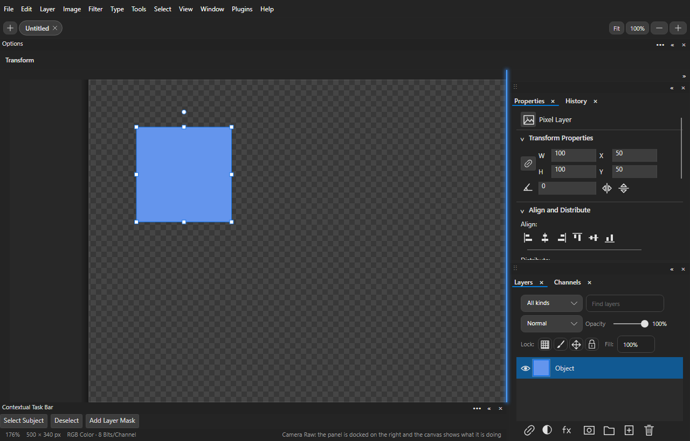
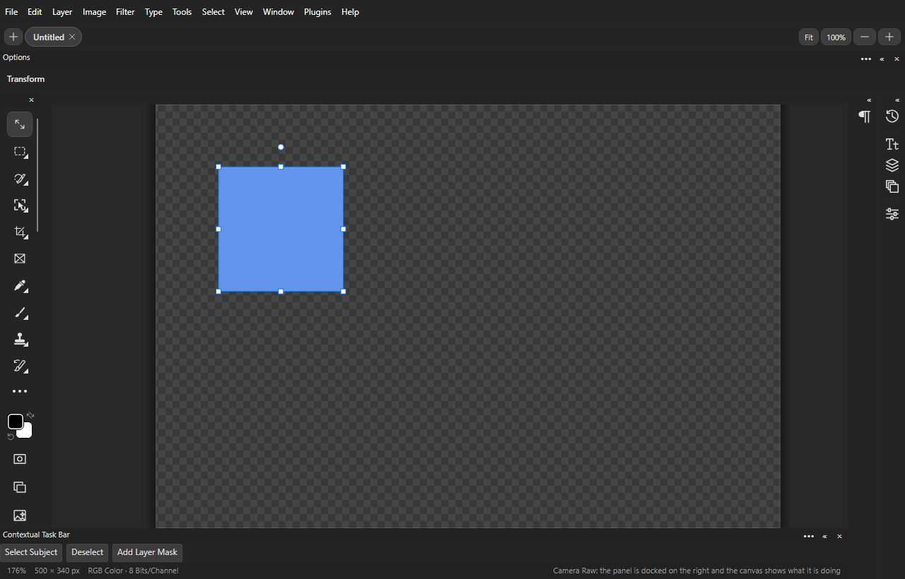

# 窗口、参考线与紧凑界面

适用于 Windows **1.5.14.0 Preview**。“窗口”和“文字”菜单各自保留。

主窗口与普通对话框沿用 32 DIP 标题栏。标题按钮采用 46×32 DIP 矩形区域和细线图形；关闭悬停为红底白色叉号，最小化／最大化在深色主题变浅、浅色主题变深。最大化后图形切为还原。普通对话框保留其原有按钮数量。浮动面板、工具栏及上下文任务栏的紧凑按钮自 1.5.14.0 起按 Photoshop 样式，见下节。

## 面板和工作区

- 单击标签文字或空白区域切换面板；标签统一为 12 像素。小于 7 个逻辑像素的移动仍视为点击。标签上没有 ×：标签行末端的 ≡ 面板菜单（或右键标签）提供“关闭”“关闭选项卡组”；浮动组标题栏的 × 关闭整组。从“窗口”或“文字 → 面板”重开。
- 拖动标签分离一个面板，拖动组标题栏移动整组。浮窗使用与当前主题一致的紧凑标题栏，可通过边缘调整大小，拖动时半透明。
- 拖到另一个组的标签栏或内容中央，带柔和光晕的蓝色边框提示合并；标签栏中的落点决定标签顺序。拖到停靠面板内容区左／右边缘创建列，上／下边缘创建堆叠分组。松开完成停靠，Esc 恢复拖动前布局；拖到编辑区空白处保持浮动。浮窗没有返回固定位置的按钮，位置由拖动落点决定。
- 每列右上角 » 只将该列折叠为窄图标栏，« 恢复该列原宽度；相邻列保持自己的宽度和状态。单击图标临时展开面板，拖动图标可分离面板。停靠组顶部只有拖动条，由所在列的 »／« 折叠；浮动组标题栏有 «／» 和 ×，标题双击同样折叠；双击标签本身不会折叠。
- 折叠状态使用 35 个专属单色图标，随深浅主题变色，悬停显示面板名称；图标栏较长时可滚动。上下文任务栏支持折叠；左工具栏的按钮切换单列／双列，选项栏不折叠。工作区保存各自状态。图标规范见 [图标设计说明](design/README.md#统一图标体系1514)。
- 组间分隔线调整高度或列宽，停靠区左侧边缘调整最左侧展开列的宽度。布局采用多列、每列上下分组、组内多个标签；支持不同面板组之间及浮窗之间的标签合并。
- 工具栏顶部细拖动条可以拖动，靠近编辑区左／右边缘时显示全高蓝色光晕，松开停靠；浮窗标题仅有缩略／展开和关闭按钮。选项栏从浮动状态左侧突出部分拖向顶部停靠，上下文任务栏拖向底部停靠，也显示提示。任务栏的三点菜单提供更多属性、隐藏、重置位置和固定位置；固定后仍可点击内部工具。
- “窗口 → 工作区”提供基本功能、图形和 Web、动感、绘画、摄影；新建工作区保存面板开关、分组、标签顺序与选择、列宽／组高、各列独立折叠状态、工具栏停靠侧、浮窗位置尺寸及任务栏固定状态。复位恢复保存的布局，删除只针对自定义工作区。锁定禁止拖动和浮动／停靠；仍可选标签。下次启动恢复所选工作区，兼容 1.5.1.2 的单面板浮窗设置；已移除显示器上的位置移回当前窗口旁。
- “键盘快捷键和菜单”分别进入快捷键编辑和菜单显示设置。F5／F6／F7／F8 分别切换画笔设置、颜色、图层、信息，Alt+F9 切换动作；均可重新分配。
- “窗口 → 排列”提供水平／垂直拼贴、双联／三联／四联／六联、三联堆积、层叠、合并至选项卡、浮动、匹配缩放／位置／旋转及新窗口。同一文档的新窗口共享内容、脏状态和撤销记录；关闭其中一个不会关闭其他视图。不同文档保持独立。预览滤镜或图层样式期间，同一文档的其他窗口暂时禁止编辑，确定／取消后恢复，避免预览与其他修改冲突。
- 文档排列使用 Windows 原生顶层窗口。面板工作区存储在用户设置中，不改动图片和项目格式；工具栏不并入普通标签组。

实际控件渲染（测试文档）：

## 浮窗与面板菜单（1.5.14）

参照 Photoshop 的面板组外观，停靠、浮动、拖动、分组和工作区逻辑不变。

- 标签：只显示面板名称。当前标签与面板内容同色并连成一体；其余标签在更暗的标签条上显示为灰色，悬停变亮；没有蓝色下划线。
- ≡ 面板菜单：每个展开的面板组在标签行末端有 ≡，菜单为“关闭”“关闭选项卡组”“浮动面板”“浮动选项卡组”（仅停靠时）“折叠为图标／展开面板”。右键标签显示同一菜单。字符、段落等面板内容自带的选项菜单不受影响。
- 组顶部：停靠组只有拖动条（右键为浮动选项卡组、折叠、关闭选项卡组）；浮动组标题栏显示组内面板名、«（折叠为图标）／»（展开）与 ×。列顶部的 »／« 折叠整列。
- 标记：«、»、×、≡ 为 1 像素整像素线，平时为次要灰色，悬停为主文字色。
## 窗口面板的实际功能

| 面板 | 功能 |
| --- | --- |
| 属性、历史记录、图层、通道 | 现有完整编辑面板，增加关闭、浮动和停靠 |
| 字符、段落、字形、字符样式、段落样式 | 与文字菜单共用面板，保留文字范围编辑和样式功能 |
| 导航器、直方图、信息 | 缩略图定位／缩放、RGB 直方图／矢量示波器、尺寸／图层／缩放信息 |
| 调整、样式 | 创建可编辑调整层、打开各类图层效果、清除效果 |
| 色板、颜色、渐变 | 预设色、前／背景色选择及渐变形状／反向 |
| 画笔、画笔设置、工具预设 | 13 类画笔设置、实际笔触预览、大小／硬度／间距、动态／纹理／双重／传递／笔势，以及带锁定的预设管理；见 [画笔手册](PAINTING-AND-GIF.md) |
| 仿制源 | 来源坐标、对齐开关和仿制图章工具 |
| 形状、路径 | 内置形状、钢笔、结束／取消路径、文字工作路径及形状预设 |
| 图案、材质、库 | 本地图像图案和 Compositor 预设的应用／导入／管理；材质是二维图案，不是 3D 材质；库不连接 Adobe Creative Cloud |
| 测量记录、注释 | 现有测量工具／记录／导出和注释选择、编辑、删除 |
| 动作 | 从已接入的同步命令添加步骤、删除步骤、顺序播放、命名保存／重载／删除；不导入 Photoshop ATN，不录制笔触和任意对话框参数 |
| 图层复合 | 可见性、位置、外观的属性复合；创建、复制、应用、局部更新、切换、删除及恢复最后状态，随 `.comp` 保存；不导出 PSD layer comps |
| 时间轴 | 视频时间轴与帧动画、片段裁切／拆分、关键帧、工作区域、链接媒体、音轨及可选 FFmpeg 渲染；GIF 逐帧编辑器继续提供计时、复制／删除／移动与 GIF 导出 |

已删除 Exchange 查找入口及其启动网页逻辑。“扩展”继续进入 Compositor 本地插件管理。插件面板同样支持关闭、浮动、停靠和工作区保存。Adobe CEP／UXP 插件不因此成为兼容格式。

## 参考线和编辑区

移到参考线上显示带平行线的双向箭头。点击选中并显示强调色；Shift 可追加选择。拖动移动参考线，锁定后禁止移动。双击直接打开首选项“参考线、网格和切片”。

画布内右键参考线可编辑方向／坐标、锁定、清除全部、清除画布参考线、清除所选参考线、清除所选画板参考线。多选编辑按同一位置偏移量移动，方向应用到所有所选参考线；清除和编辑均可撤销。创建时若选中画板或其子层，参考线记录画板归属；已删除画板的参考线作为画布参考线处理。画板归属使用 Windows 项目格式 v21。

画布外右键提供默认、黑色、深灰、中灰、浅灰、自定及颜色选择器。默认随主题变化；自定颜色可保存。参考线和编辑区颜色不影响导出像素。

## 本版修复与验证

浅色主题更新图层／通道实际行背景和共享控件；子菜单紧凑排布，属性三点按钮更易识别。图层样式滑块采用完整的轨道和圆钮，支持拖动、点击和数字输入。普通 Esc 提交文字并结束编辑；Ctrl+Esc 放弃本次文字修改。文字编辑期间 Ctrl+A／C／X／V 分别用于文字全选、复制、剪切和粘贴，状态栏显示对应退出提示。

`--docking-checks` 使用真实路由输入检查标签点击／轻微移动、跨组合并／排序、上下与左右分栏、各列独立折叠／原宽度恢复、左右工具栏停靠、光晕像素和高亮居中、浮窗整组关闭／重开、工作区序列化／恢复、任务栏固定、Esc 拖动还原、共享文档、参考线、主题、文字退出、滑块端点及拖动；中文、英文均纳入 CI。该自动检查不能代替多显示器、Windows 10 实机和真实输入法的人工验收。OpenCL 迁移仍暂缓，渲染继续使用 Skia。

## 移动、画板与视图导航

- 顶层菜单采用当前主题色，保持文件、编辑、图像、图层、文字、选择、滤镜、视图、增效工具、窗口、帮助的顺序。工具命令位于“编辑 → 工具”，也可通过选项栏搜索按钮查找。没有“发现”或 Adobe 服务入口。
- 选项栏只有工具选项，没有标题、面板选项、关闭或折叠按钮。当前工具用图案表示，旁边下拉箭头打开工具预设。右键选项栏可浮动，浮动后拖动左侧突出部分停靠；停靠时突出部分隐藏。右侧工作区按钮可切换、复位、保存和删除工作区。
- 移动工具：自动选择可指定图层或组；Ctrl 临时反转自动选择，Shift 扩展选择。“显示变换控件”控制边框。直接按钮和三点弹出框执行对齐／分布，参考范围支持自动、选中图层、画布、选区。齿轮控制画布悬停边框、单击展开组及图层列表悬停边框。V 在可用的移动／画板工具间切换。
- 工具预设支持新建、重命名、删除、排序、当前工具过滤、三种列表大小、管理器、当前／全部工具复位，以及 JSON 载入、保存、替换。复位预设前保存 `.bak` 副本。画笔类预设可转换为画笔预设。预设保存在设置目录的 `tool-presets.json`；它不是 Adobe TPL 格式。
- 画板工具：长按／右键移动工具组选取画板，或再次按 V。拖出矩形创建画板，单击空白按当前尺寸创建；Esc 放弃尚未完成的拖动。可选参考截图中的移动设备、网页、桌面和图标预设，编辑宽高，切换横／竖方向；加号在当前画板右侧新建画板。背景支持白、黑、透明、自定义颜色。对齐菜单支持六种对齐和横／纵间距分布。调整画板大小不缩放其内容，移动画板携带内容。
- 画板齿轮：自动嵌套按图层中心点归属画板；自动画布大小在创建／修改时扩展文档；跨画板重新排序可保持相对位置；保存时可收缩文档至全部画板的包围框。后两项属于文档编辑，可撤销。画板背景的 ARGB 值随项目保存：非白色背景需要 Windows v22；旧文件缺省为白色。上游 macOS 不支持这些 Windows 扩展。
- 左工具栏停靠时只有单／双列按钮；浮动时另有关闭按钮。单列为 46、双列为 82 逻辑像素宽。标题栏统一约 11 像素，标签栏仍保持原高度。切换列数、停靠位置和浮动尺寸可随工作区恢复。
- 移动工具的边／角显示对应方向缩放光标，边框外侧区域显示旋转光标；方向随对象及视图旋转。裁剪控制点、竖排文字、放大／Alt 缩小、钢笔增删锚点也有对应光标；画笔圆圈、仿制取样靶心、参考线和空格平移继续沿用已有交互。
- 单击画板外空白取消图层选择，属性面板显示文档信息。导航器和变换控制点优先处理自己的点击。
- 标尺启用时，上／左标尺跟踪鼠标位置并显示文档坐标，按标尺单位换算；离开画布后隐藏追踪。画布右侧常驻纵向滚动条，横向滚动条嵌入窗口最底部信息栏中间，左侧保留缩放及图像尺寸，右侧保留状态消息。拖动滑块、点击轨道／箭头和键盘滚动均平移视图；缩放、旋转和导航器移动后同步滑块。

验证入口：`--chrome-checks` 覆盖选项栏、工作区恢复、工具预设、画板背景／撤销、坐标追踪、滚动和变换光标；`--docking-checks` 继续检查浮窗合并、分列和模糊蓝色停靠提示。

主窗口保留原生可调整大小的外框，Windows 11 使用原生圆角；标题栏显示本项目 `compositor.ico` 中原样提取的 logo，窗口控制按钮使用居中的 15 像素矢量图案。最大化时遵循系统边框行为。Windows 10 原生窗口边角仍遵循系统外观。

## 1.5.3.0 标题与滚动条

浮窗标题中的面板选项、折叠／展开及关闭图案放大并上下居中，所有三点圆点与自定义工具栏按钮保持相同大小。上下文任务栏在新布局／恢复默认时关闭，旧工作区保留可见性；停靠时不显示名称。深灰主题的原生上边框跟随主题色，关闭按钮悬停为红色；标题继续使用项目 logo，保留系统圆角外框。

滚动条在四套主题中采用矩形实心滑块与轻微圆角；深色轨道配较亮滑块，浅色轨道配较暗滑块。横向滚动条仍位于最底部信息栏中间，右侧纵向滚动条常驻。选区、裁剪与切片的新选项见 [操作手册](SELECTION-CROP-SLICE.md)。

## 1.5.3.1 共用窗口标题栏

主窗口与应用弹窗共用 32 DIP 高标题栏，标题背景和边框随四套主题切换；关闭按钮悬停红色。主窗口最小化、最大化／还原、关闭按钮和弹窗采用一致的控制图形；菜单按钮高度、字体与 logo 尺寸保持不变。Windows 11 外框保持系统圆角。

图层面板从上到下为类型筛选（可组合、可整体停用）、混合模式与不透明度、锁定与填充、图层列表、底部动作。选择“名称”可输入筛选文字；不透明度支持输入百分比及下拉滑块。列表保留可见性切换、分组展开、缩略图、重命名、拖动顺序和上下文菜单。

## 1.5.13.0 选项栏更新

渐变、油漆桶、局部修饰、调整画笔、视图及路径选项的当前行为见[填充、修饰与视图工具](TOOL-OPTIONS.md)。画笔预设采用四组双列原创笔触卡片；浮窗标题按钮按 Photoshop 样式。
