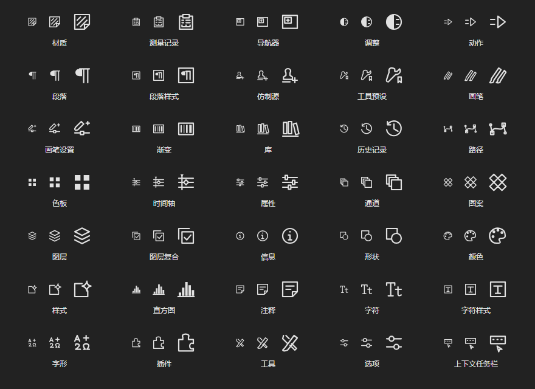
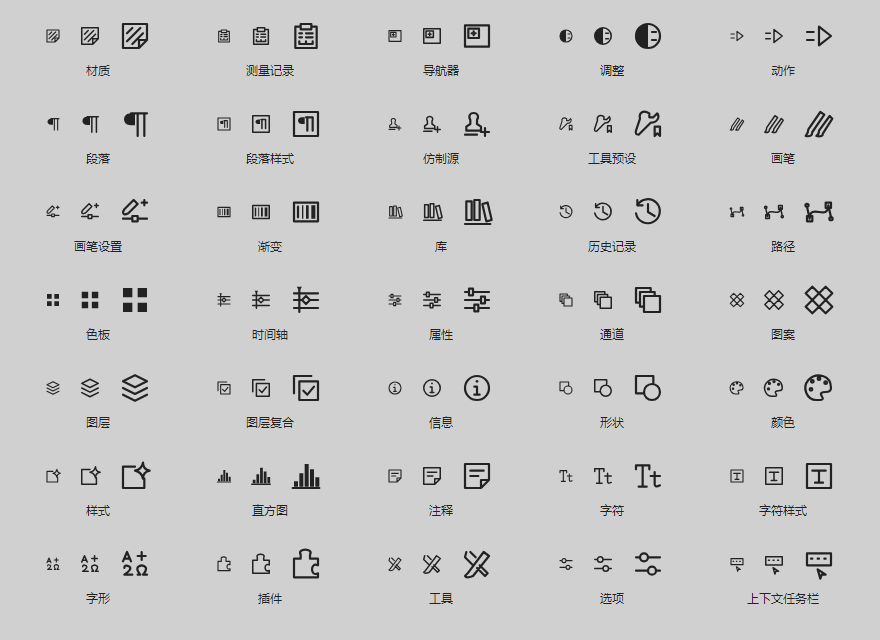

# 面板折叠图标

适用于 Windows **1.5.2.0 Preview**。覆盖“窗口”菜单中的 31 个面板，加上插件、工具、选项、上下文任务栏，共 35 个专属图标。仅用于面板／工具浮窗折叠状态，左侧工具栏的 69 个按钮保持现状。

本轮按用户要求使用 **imagegen skill + 内置 imagegen**，每个图标单独调用生成工具，共 35 次。设计含义参考 Photoshop；造型、线宽和主题颜色沿用 Compositor。工具没有返回实际模型身份，因此不声明具体图像模型名称。

- [完整提示词及逐项映射](prompts.json)：每项包括生成参考和 SVG 路径。
- [生成稿目录](references)：保留 35 张工具返回的原始 PNG；不是运行时缩略图。
- [SVG 目录](svg)：由运行时同一组矢量路径导出，使用 `currentColor`。
- [运行时控件](../../src/Compositor.Desktop/DockPanelGlyph.cs)：24 单位网格、1.65 单位轮廓、圆端点／圆接角；折叠按钮中显示为 22 逻辑像素。

生成图中的纹理、复杂细节和不适合缩小的留白，经人工矢量适配移除。不同面板保持不同图形：例如图层为叠层，通道为错位方框，字符为 Tt，字符样式为框内 T，段落为段落符号，段落样式为框内段落符号。使用项目主题画刷，无网络依赖，不捆绑 Adobe 图标资源。

以下为应用的真实控件渲染，每组从左到右为 16、22、32 逻辑像素，用于检查小尺寸辨识度、笔画与裁切；不是生成图的拼贴。

`--docking-checks` 同时检查完整映射、不同图案、工具折叠与点击展开、原尺寸恢复、保存／恢复工作区，并输出中英文的深浅主题图集。更多停靠操作见 [窗口说明](../../WINDOW-MENU.md)。
